Corse:web technologies (frontend)
Member of group:IT-2503
-Atshybai Nurbolsyn, Assignment4

Assignment #4, Forms and Validation.
Part 1. Basic HTML Forms

Task 0. Simple Contact Form
-the task0 asks us just create normal form and there need to be Name,Email,Messege,and Submit button
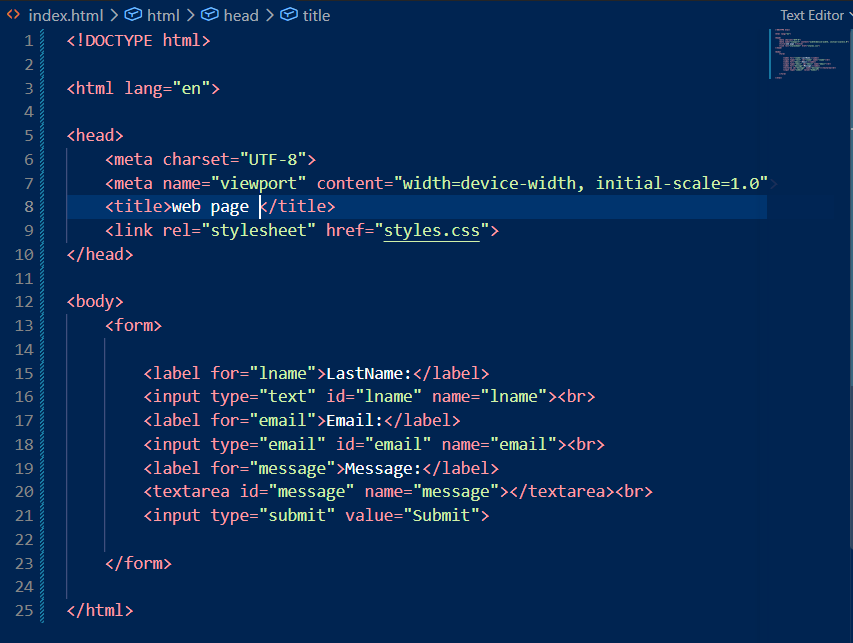 there is the task0's code used there the <label> and it's a tag defines a label for many form elements.
and its for now looks like this 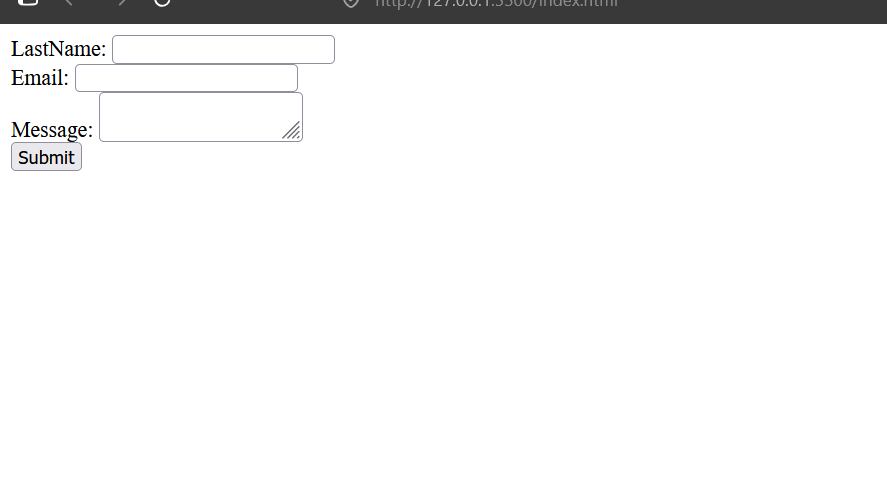
-task1

On task1 asks that using (required,Maxlenght,minlenght etc) our code now 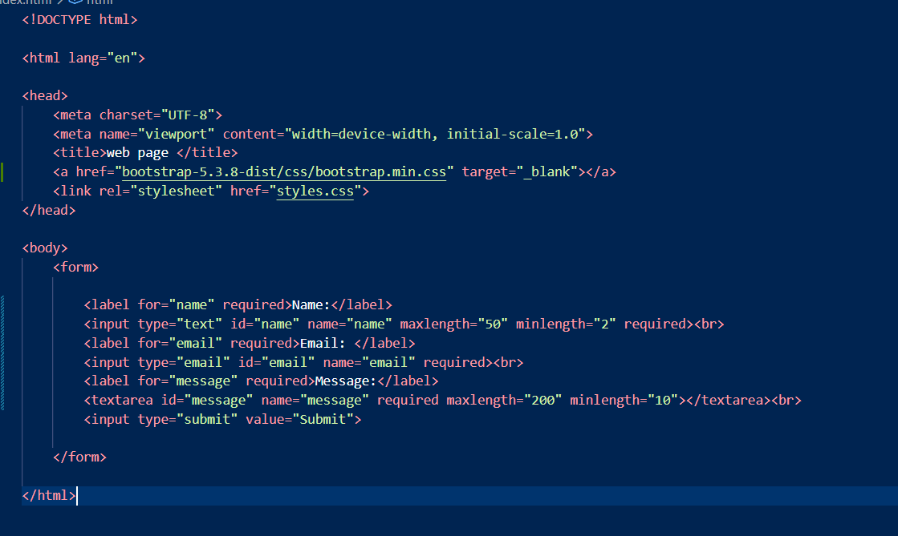 so our page works like the forms cant be a empty and there have max and min characters.

-task2
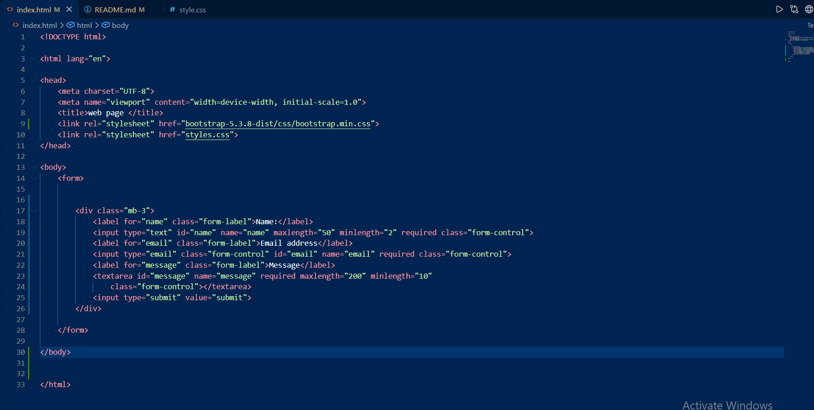 There u can see that we have changed all old code and our web looks like this 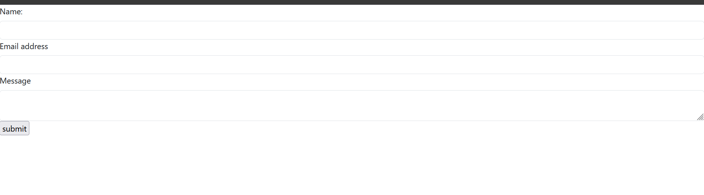 the second task we used boostrap style u can see that 
 and its looks better

-task2.3
there added some messeges for user 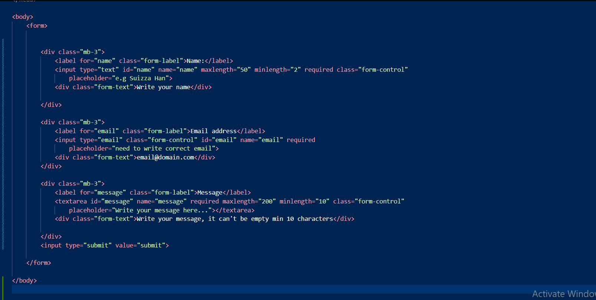 and its looks like 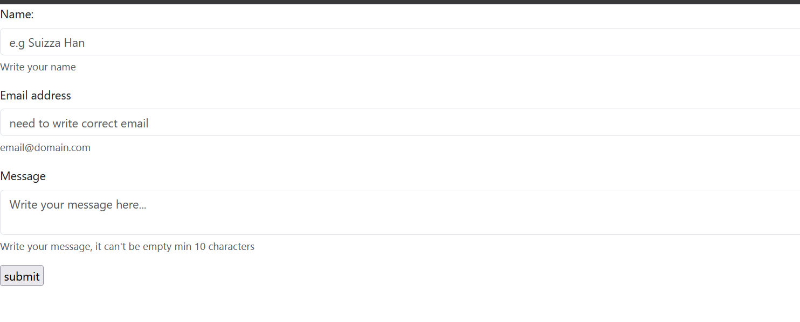 here added some Bootstrap gird
-

-task3
The Regestration page for this i created the second html file and code's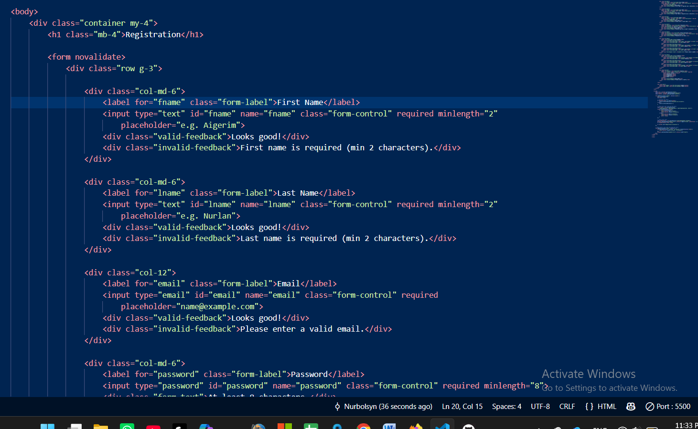 ,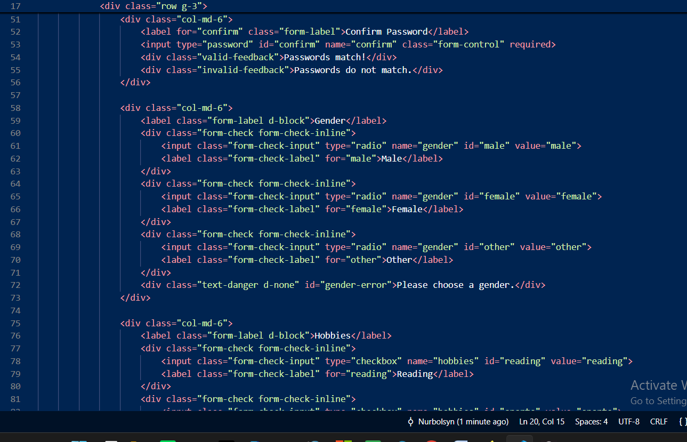,  and it's looks on web like this 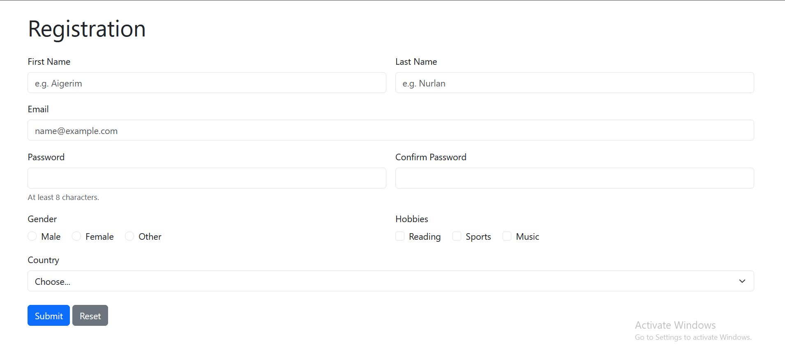

and regestration page included all criterias 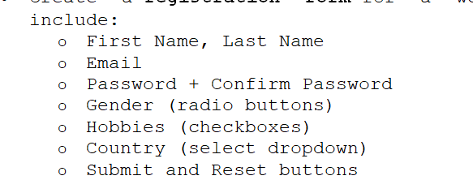 
